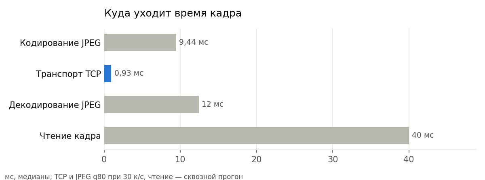
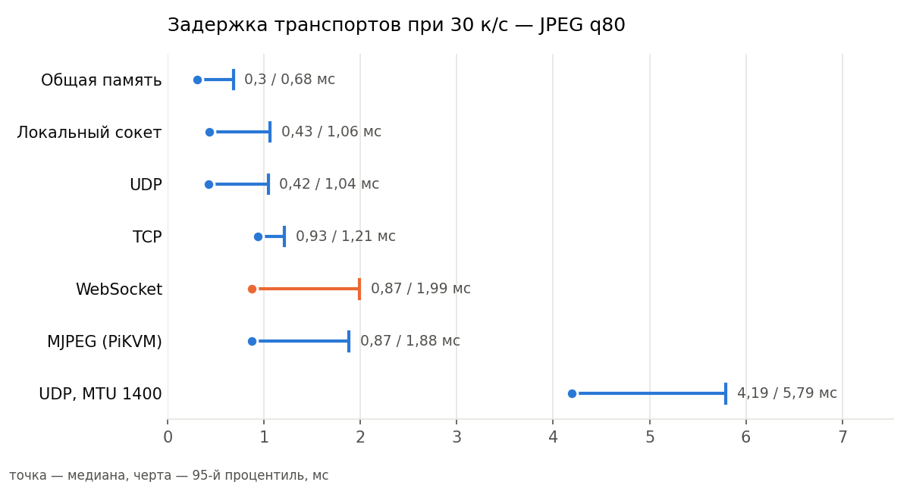
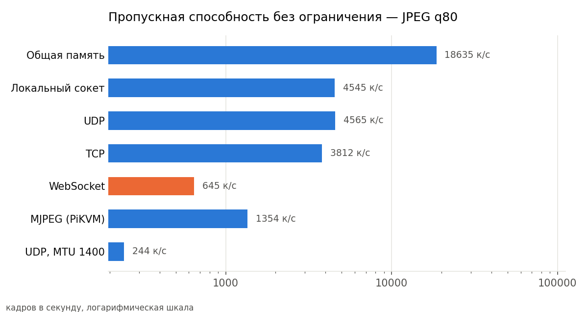
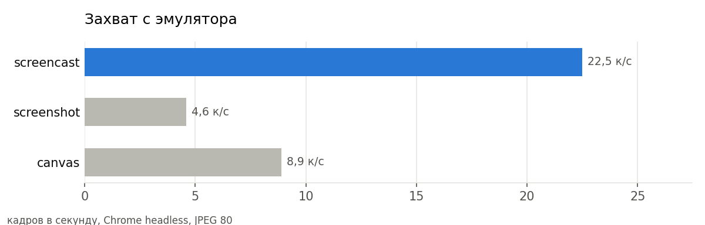
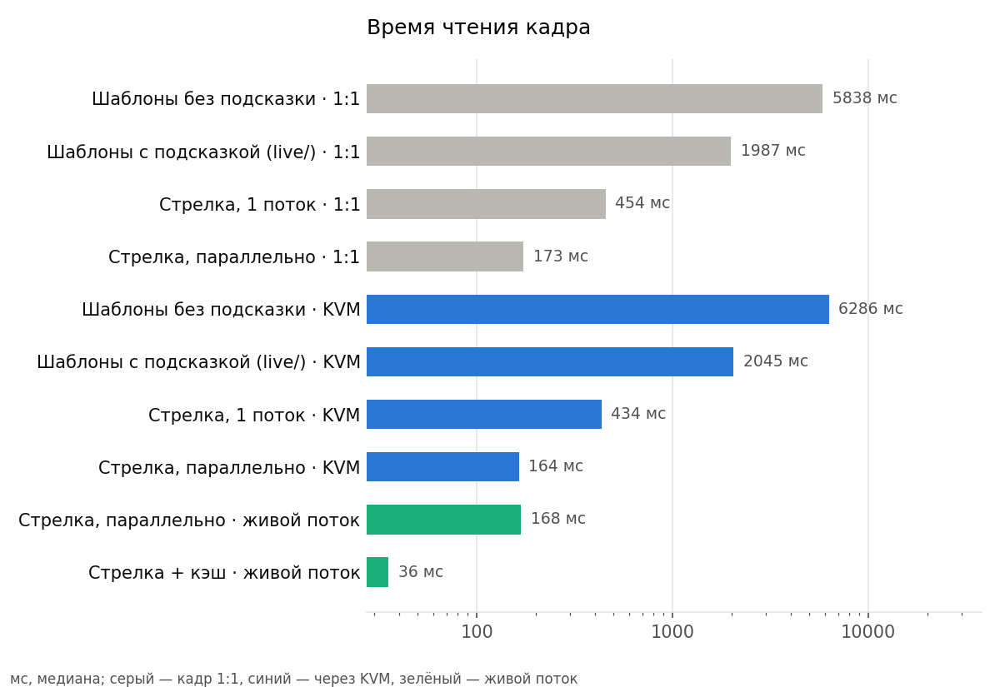
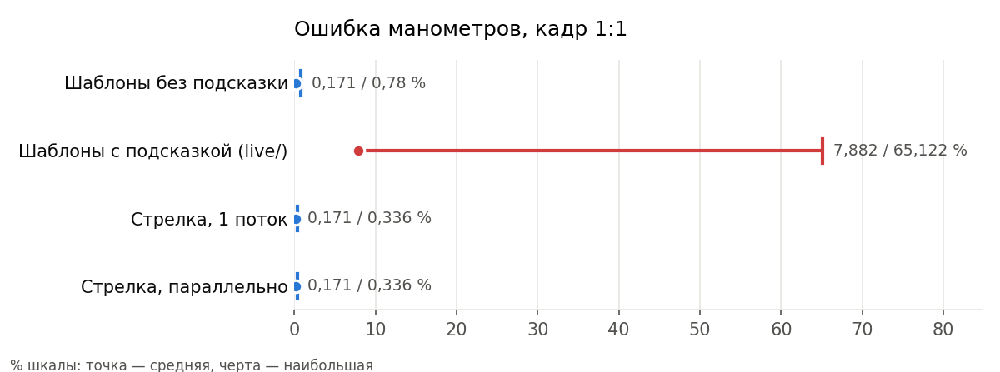

# Двусторонний контур: картинка щита → распознавание → управление щитом

`live/` читает щит с KVM-трансляции и только показывает прочитанное: связь
односторонняя. Здесь контур замкнут. Приёмник видит только пиксели, как и
раньше, но теперь он ещё:

* копит прочитанное и считает то, чего на щите нет (дебит нефти, тренды,
  время до уставки, перекрёстная проверка приборов);
* управляет щитом мышью — через тот же канал, что HID у KVM, — и проверяет
  по следующим кадрам, что команда сработала;
* выводит свои подсказки обратно на экран щита.

```
ПК-1: emulator.py                                        ПК-2: receiver.py
  Chrome + neft-hmi-cv.html                                 приём ─▶ нормализация ─▶ чтение (fast_reader)
     │ захват (screencast | screenshot | canvas | screen)                                │
     ▼                                                                                   ▼
  транспорт  tcp | ws | udp | pipe | shm | mjpeg  ─────────────────▶            агрегатор (aggregator)
                                                                                         │
  клик / клавиша / подсказка  ◀── обратный канал (JSON по TCP) ◀── управление и автоматика (control)
                                                                                         │
                                                                         сайт оператора http://127.0.0.1:8771
```

## Запуск

```bash
pip install -r bridge/requirements.txt        # opencv-python numpy websockets playwright mss
```

Браузер Playwright качать не нужно: эмулятор запускает установленный Chrome
(если его нет — Edge, затем собственный Chromium Playwright).

Два терминала:

```bash
python bridge/emulator.py                     # ПК-1: щит, видео tcp :8780, обратный канал :8790
python bridge/receiver.py                     # ПК-2: приём, распознавание, сайт :8771
```

Открыть http://127.0.0.1:8771/ — показания, расчётные величины, события,
пульт, автоматика, тестовый канал.

Проверить весь контур одной командой (сам поднимет оба процесса и сверит
результат с моделью):

```bash
python bridge/e2e_test.py                     # или --transport ws | shm | pipe | udp | mjpeg
```

На разных машинах: эмулятор с `--host 0.0.0.0`, приёмник с
`--host <адрес ПК-1> --control <адрес ПК-1>:8790`.

### Ключи

| emulator.py | зачем |
|---|---|
| `--transport tcp` | `tcp`, `ws`, `udp`, `pipe`, `shm`, `mjpeg` |
| `--capture screencast` | как снимать картинку, см. ниже |
| `--fps 30`, `--quality 80` | потолок частоты и качество JPEG |
| `--strip 120` | полоса подсказок под щитом, px; `0` — чистый кадр 1920×1080 |
| `--speed 600`, `--layout B`, `--start-pump` | ускорить время модели, сменить компоновку, сразу запустить насос |
| `--headed` | показать окно (обязательно для `--capture screen`) |

| receiver.py | зачем |
|---|---|
| `--transport`, `--host`, `--port` | откуда брать видео |
| `--source URL\|N\|папка` | вместо транспорта — источник из `live/`: MJPEG PiKVM, карта захвата, файлы |
| `--control host:port` / `none` | обратный канал эмулятора; `none` — только чтение |
| `--pikvm https://pikvm.local` | мышь настоящего PiKVM вместо эмулятора (см. ограничения) |
| `--gauge-method needle\|template` | манометры по стрелке (по умолчанию) или перебором шаблонов, как в `live/` |
| `--no-cache` | перечитывать все объекты каждый кадр |
| `--auto` | сразу включить правила автоматики |
| `--no-assist` | не выводить подсказки на экран щита |

## Чем это отличается от варианта с KVM

| | `live/` + KVM | `bridge/` |
|---|---|---|
| как кадр попадает к распознаванию | HDMI → Pi Zero 2 → MJPEG по сети | программный «HDMI»: захват из браузера → один из шести транспортов. MJPEG-вариант совместим с PiKVM и `live/run.py` |
| кадр | масштаб захвата, поля, JPEG — калибровка нужна всегда | 1:1 (1920×1200 вместе с полосой подсказок); калибровка проверяет «один к одному» за миллисекунды, а полная многомасштабная остаётся на случай настоящего KVM |
| чтение манометров | перебор 55 масочных шаблонов на прибор | угол стрелки по лучам из центра; шаблоны — запасной путь |
| скорость чтения кадра | 1,2–2 с, первый 7 с | 35–170 мс, первый ~0,5 с |
| связь | только чтение | обратный канал: клик мышью, клавиша, подсказки на экран |
| что делается с прочитанным | показывается | копится, фильтруется, обогащается, порождает события и команды |

Принцип прежний: ни приёмник, ни управление не знают ни модели, ни
координат приборов. Кнопка «ПУСК» для управления — такой же объект
распознавания, как манометр: её место берётся из текущего кадра. Сквозной
тест это проверяет: после перестановки блоков (компоновки B, C, D двигают
5–7 блоков из 7) пуск и останов всё равно попадают по кнопкам.

## Результаты замеров

Машина: Intel Core 10-го поколения, 12 логических ядер, Windows, Python 3.10.
Полные таблицы — в [`results/`](results/).

**Наглядный отчёт** — [`results/report.html`](results/report.html): один файл,
открывается двойным щелчком, интернет не нужен. В нём все графики с
подсказками при наведении, переключатель кодека для транспортов, таблицы и
итоги сквозных проверок; светлая и тёмная тема по настройке системы. Те же
графики картинками — в [`results/charts/`](results/charts/). После новых
замеров отчёт пересобирается:

```bash
python bridge/make_report.py
```



### 1. Транспорт: не узкое место

JPEG q80 (≈290 КБ на кадр), 30 к/с, источник и приёмник — разные процессы
на одной машине ([`results/transport.md`](results/transport.md)):

| транспорт | задержка p50 | p95 | доставлено |
|---|---:|---:|---:|
| `shm` — общая память + звонок | 0,3 мс | 0,7 мс | 100 % |
| `pipe` — локальный сокет (named pipe) | 0,4 мс | 1,1 мс | 100 % |
| `udp` — датаграммы по 60 КБ | 0,4 мс | 1,0 мс | 100 % |
| `tcp` — пакеты с длиной | 0,9 мс | 1,2 мс | 100 % |
| `ws` — WebSocket | 0,9–1,7 мс | 2,0 мс | 100 % |
| `mjpeg` — HTTP, как у PiKVM | 0,9–2,9 мс | 1,9–3,2 мс | 100 % |
| `udp:1400` — датаграммы размером с MTU сети | 4,2 мс | 5,8 мс | 100 % |

Что из этого следует:

* **Разница между транспортами — доли миллисекунды** при бюджете кадра 33 мс.
  Кодирование JPEG стоит ~10 мс, декодирование ~12 мс, захват из браузера —
  45 мс между кадрами, чтение — 35–170 мс. Выбирать транспорт стоит по
  удобству, а не по скорости.
* **WebSocket против локального сокета** на рабочем режиме: 0,9–1,7 мс против
  0,4–0,9 мс. Разница заметна только на предельной пропускной способности
  (650 к/с у `ws` против 3800–4500 у `tcp`/`pipe`) и на сыром кадре 6 МБ
  (65 мс у `ws` против 14 мс у `tcp`): библиотека `websockets` написана на
  чистом Python.
* **Сырой кадр** (6 МБ, без кодека) выгоден только через общую память:
  2,6 мс против 14–22 мс у сокетов. По сети гонять его незачем, 1,5 Гбит/с.
* **UDP** на localhost быстр, но в сети с MTU 1500 кадр режется на ~210
  датаграмм, и Python не успевает: 4 мс на JPEG и всего 12 к/с на сыром
  кадре. Потеря одной датаграммы губит весь кадр.
* **Глубокий буфер сокета = задержка.** С 8-МБ буферами отставший приёмник
  копил ~2,5 с старых кадров. Поэтому у потоковых транспортов буфер 2 МБ,
  а у каждого подключения источника — ящик на один кадр: свежий вытесняет
  старый.





Рекомендация: на одной машине — `shm` или `pipe`; между машинами — `tcp`;
если поток должен смотреть браузер напрямую — `ws`; для совместимости с
PiKVM и `live/run.py` — `mjpeg`.

### 2. Захват с эмулятора

[`results/capture.md`](results/capture.md):

| способ | к/с | интервал p50 |
|---|---:|---:|
| `screencast` (CDP, браузер сам кодирует JPEG после отрисовки) | 22,5 | 42 мс |
| `canvas` (`toDataURL` в странице) | 8,9 | 110 мс |
| `screenshot` (CDP, по запросу) | 4,6 | 216 мс |

Потолок задаёт сама страница: щит рисуется программно примерно 30 раз в
секунду.

 Флаги Chrome, снимающие ограничение частоты кадров, screencast
ломают.

### 3. Чтение: главный выигрыш

14 контрольных режимов, истина — JSON модели на каждом кадре
([`results/reader.md`](results/reader.md)):

| вариант | точность | манометры: ср. / макс. ошибка | кадр |
|---|---:|---:|---:|
| шаблоны без подсказок (`match_templates.py`) | 99,46 % | 0,17 / 0,78 % шкалы | 5,9 с |
| шаблоны с подсказкой (`live/recognize.py`) | 97,51 % | 7,9 / 65 % шкалы | 1,9 с |
| стрелка, один поток | 99,46 % | 0,17 / 0,34 % шкалы | 0,44 с |
| стрелка, параллельно | 99,46 % | 0,17 / 0,34 % шкалы | 0,16 с |
| то же через имитацию KVM (1280×800, JPEG 70) | 99,03 % | 0,33 / 0,73 % шкалы | 0,16 с |
| стрелка + кэш, живой поток | — | — | 35 мс |





Три ускорения в [`fast_reader.py`](fast_reader.py):

1. **Манометр по стрелке.** Из известного центра циферблата — лучи через
   0,5°, вдоль каждого считается краснота `R − max(G, B)` на радиусах
   25–72 %. Угол — центр тяжести пика. Одна `cv2.remap` на прибор вместо
   55 сопоставлений с маской (а с маской OpenCV не считает через БПФ). При
   неуверенном пике — откат на шаблоны.
2. **Кэш неизменившихся объектов.** У каждого объекта хранится уменьшенный
   отпечаток его области; не изменилась и блок не сдвинулся — берётся
   прошлый результат. На живом потоке перечитывается 5–15 объектов из 81.
   Кэш освежается по кругу — по десятой части объектов на кадр: так
   медиана кадра 35 мс вместо 15, зато нет пиков по полсекунды, которые
   давало бы перечитывание всего разом.
3. **Параллельно.** `matchTemplate` и `remap` отпускают GIL, пул потоков
   реально занимает ядра.

### 4. Весь контур

[`results/e2e_tcp.md`](results/e2e_tcp.md) и рядом — для `ws` и `shm`:

| | tcp | ws | shm |
|---|---:|---:|---:|
| канал, к/с | 19 | 19 | 19,5 |
| задержка канала p50 | 0,7 мс | 1,5 мс | 0,4 мс |
| чтение кадра | 41–98 мс | 87 мс | 111 мс |
| от захвата до показаний | 77–133 мс | 168 мс | 160 мс |
| RTT обратного канала | 0,7 мс | | |
| проверки (пуск, частота, штуцер, останов, три перестановки) | все | все | все |

Время «от захвата до показаний» почти целиком — распознавание и очередь
к нему; транспорт в нём — меньше процента. Цифры — одиночные срезы по
нескольким прогонам: чтение кадра зависит от того, сколько объектов
изменилось и пришёлся ли на кадр полный поиск блоков.

## Найденные по дороге дефекты исходного кода

* **Подсказка угла в `live/recognize.py` ловит ложный пик.** Если стрелка
  прыгнула (смена режима, отключение насоса), поиск около прошлого угла
  находит локальный максимум выше порога 0,88 и не идёт на полный перебор:
  на контрольном наборе 18 из 84 манометров неверны, ошибка до 65 % шкалы.
  Без подсказки те же шаблоны дают 84 из 84. Стрелочный метод этой ловушки
  не имеет. `live/` не правился.
* **Блок «журнал» портит балл привязки.** Приборов в нём нет, а текст
  меняется — балл 0,2–0,4, и по правилу «худший блок < 0,45» поиск блоков
  запускался на каждом кадре. Здесь блоки без приборов не привязываются, а
  качество — медиана по блокам.
* **Столбчатые при полных шкалах привязываются со сдвигом 10–15 px**
  (балл до 0,18: блок почти целиком — заливка). Приборы внутри читаются
  верно — их окрестность поиска шире, — но перестановкой такой сдвиг
  здесь не считается.

## Агрегатор: что добавляется к прочитанному

[`aggregator.py`](aggregator.py):

* медиана по трём чтениям — одиночный сбой распознавания не порождает ни
  события, ни команды; уставки и правила включаются только после трёх чтений;
* **дебит нефти** = дебит жидкости × (1 − обводнённость);
* **перекрёстная проверка**: дебит показан и стрелкой, и цифрами —
  расхождение дольше 3 с становится событием;
* скорость изменения каждого параметра и **время до уставки** при нынешнем
  тренде: до отключения по перегреву, до заполнения РВС, до срыва подачи;
* опережающие уставки с гистерезисом (ниже тех, где модель отключает насос
  сама) — температура и ток ПЭД, погружение, изоляция, вибрация, уровни;
* смена состояний ламп, тревог, задвижек, насосов — с антидребезгом;
  мигающая неквитированная тревога распознаётся как «мигает», а не сыплет
  «вкл/выкл»;
* готовность за сеанс, число пусков и аварийных остановов;
* выгрузка истории в CSV для Excel (`/api/history.csv`).

## Управление

[`control.py`](control.py). Каждая команда: найти орган управления в
текущем кадре → перевести точку из координат щита в координаты кадра
трансляции → клик через HID → дождаться подтверждения на следующих кадрах.

| команда | как проверяется |
|---|---|
| пуск / стоп / авар. стоп | лампа «НАСОС В РАБОТЕ» / «ОСТАНОВЛЕН» / «АВАРИЯ ЗСП». Не загорелась — команда «не подтвердилась», и в журнал пишется, что видно (например, «горит АВАРИЯ ЗСП — пуск запрещён защитой») |
| режим, АПВ, ингибитор | соответствующая лампа сменила состояние |
| задание ЧРП N Гц | замкнутый контур: задание цифрой на щите не читается, но фактическая частота на индикаторе в ручном режиме выходит на задание. Ждём, пока частота перестанет меняться, считаем недостающие шаги по 0,5 Гц, жмём, повторяем |
| штуцер N % | открытый контур: положение цифрой не читается, поэтому как у шагового двигателя без датчика — сначала в упор (20 %), затем нужное число шагов по 5 % |
| ±0,5 Гц, ±5 %, квитирование, промывка, ТКРС | нажатие; блокировка частоты в режиме АВТО учитывается |

Аварийный останов требует подтверждения. Автоматика — правила «условие на
прочитанном → команда», по умолчанию выключены, включаются на сайте:
температура ПЭД ≥ 115 °C, ток ≥ 42 А, погружение ≤ 100 м → задание ЧРП
−1 Гц, с паузой 30 с между срабатываниями.

## Подсказки на экране щита

У настоящего KVM дорисовать что-либо на экран ПК-1 нельзя — только мышь и
клавиатура. Эмулятор этого ограничения лишён: монитор делается 1920×1200,
щит остаётся 1920×1080 сверху, а в полосу под ним приёмник раз в секунду
выводит расчётные величины, вышедшие за уставки параметры и последние
события. Распознаванию полоса не мешает: нормализация вырезает щит по шапке.

## Ограничения

* **PiKVM-мышь не проверена на железе.** `PiKvmHid` написан по описанию
  HTTP API kvmd (`/api/hid/events/send_mouse_move`, `send_mouse_button`,
  абсолютные координаты −32768…32767), живого PiKVM под рукой не было.
* **Захват экрана монитора** (`--capture screen`) и клики мышью ОС —
  реализованы для Windows, но не прогонялись: такой тест захватил бы экран
  и мышь рабочей машины.
* Задание штуцера — без обратной связи: положение на щите цифрой не
  читается, текстовые табло распознаванием не читаются вовсе.
* Тестовый канал (`op=scenario`, `op=truth`) — только для стенда: им
  пользуются кнопки отказов на сайте и сквозной тест для оценки. Чтение и
  управление истину модели не видят.
* Сайт без авторизации; по умолчанию слушает только 127.0.0.1.
* Задержка источник → приёмник меряется вычитанием `perf_counter` и честна
  только на одной машине; между машинами смотрите RTT обратного канала.

## Файлы

| файл | что делает |
|---|---|
| [`emulator.py`](emulator.py) | ПК-1: Chrome со щитом, захват, отправка, исполнение команд, полоса подсказок |
| [`capture.py`](capture.py) | способы захвата: screencast, screenshot, canvas, screen |
| [`protocol.py`](protocol.py) | заголовок кадра, кодеки, часы |
| [`transports.py`](transports.py) | шесть транспортов с общим интерфейсом, статистика канала |
| [`receiver.py`](receiver.py) | ПК-2: приём, нормализация, чтение, агрегация, управление, сайт |
| [`fast_reader.py`](fast_reader.py) | чтение щита: стрелки, кэш, параллельность |
| [`aggregator.py`](aggregator.py) | история, расчёт, уставки, события |
| [`control.py`](control.py) | HID-каналы, команды с проверкой, автоматика |
| [`web.py`](web.py), [`dashboard.html`](dashboard.html) | сайт оператора |
| [`bench_transport.py`](bench_transport.py) | замер транспортов |
| [`bench_capture.py`](bench_capture.py) | замер способов захвата |
| [`bench_reader.py`](bench_reader.py) | сверка способов чтения: точность и скорость |
| [`e2e_test.py`](e2e_test.py) | сквозная проверка всего контура |
| [`make_report.py`](make_report.py) | наглядный отчёт: `results/report.html` и графики `results/charts/*.png` |
